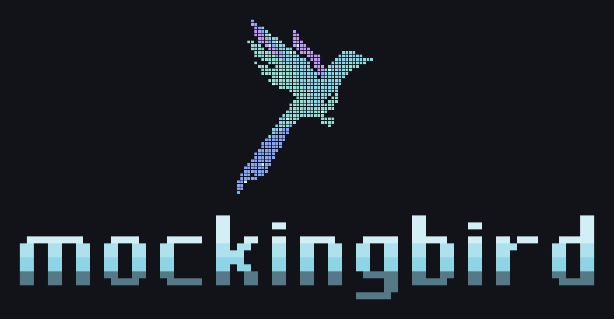

<h3 align="center">
  
</h3>

<p align="center">
  The video editing engine for AI agents. Your agent edits real footage with it, on your computer. Free, every feature.
</p>

<p align="center">
  <a href="https://github.com/NirjharBhattacharjee/mockingbird/stargazers"></a>
  <a href="https://github.com/NirjharBhattacharjee/mockingbird/commits/main"></a>
  
  
  
  
  
  <a href="LICENSE"></a>
</p>

<p align="center">
  
</p>

You give your AI agent a recording. It gives you back an edited video.

mockingbird works with Claude Code, Codex, Cursor, Gemini CLI, or any agent
that speaks MCP. Your agent decides the edit, and mockingbird does the work
on your computer. It transcribes the speech, cuts on word boundaries,
frames the speaker for a vertical video, adds word-by-word captions, b-roll,
music and motion graphics, and sets the loudness to what YouTube plays at.

Your footage never leaves your computer. There's no account, no cloud and no
usage limit, and nothing is held back for a paid tier
([why](docs/PHILOSOPHY.md)).

## 🎬 What you can ask for

Once it's set up, talk to your agent the way you'd brief an editor:

> Cut a 60-second vertical short with captions from ~/Movies/talk.mp4.

> Edit ~/Movies/tutorial.mov into a tighter YouTube video. Cut the long
> pauses and false starts, and write chapters.

> Transcribe ~/Desktop/interview.m4a.

For a short, the agent transcribes the video, picks the best moment, looks
at stills to find the speaker, frames the shot, makes the captions and
renders. You get an MP4 next to the original. mockingbird never overwrites
a file.

## 🚀 Install

You need about 3 GB of free space, plus one of these:

- a Mac with [Homebrew](https://brew.sh)
- Linux with git, curl, ffmpeg and unzip from your package manager
- Windows x64

The speech model is Whisper `large-v3` on Apple Silicon (1.1 GB) and the
smaller `small` elsewhere (0.2 GB), which a CPU keeps up with.

On a Mac or Linux, run this in a terminal:

```sh
curl -fsSL https://github.com/NirjharBhattacharjee/mockingbird/releases/latest/download/install.sh | bash
```

On Windows, run this in PowerShell:

```powershell
irm https://github.com/NirjharBhattacharjee/mockingbird/releases/latest/download/install.ps1 | iex
```

The installer also downloads the headless Chrome that captions and motion
graphics are drawn in (about 150 MB, with the fonts they use). There's no
Chrome build for Linux on ARM yet, so there it warns and carries on: set
`MOCKINGBIRD_CHROME` to a Chrome that runs, for motion graphics. Captions
fall back to ffmpeg without one.

It's all safe to run again. You can also install with Homebrew:

```sh
brew install nirjharbhattacharjee/mockingbird/mockingbird
mockingbird models pull
mockingbird models pull chrome
```

Or install [by hand](docs/README.md#manual-install).

### Let your agent install it

Paste this into your agent and it runs the installer, checks it, and
connects mockingbird to itself:

```text
Set up mockingbird on this computer by following
https://raw.githubusercontent.com/NirjharBhattacharjee/mockingbird/main/docs/AGENT_INSTALL.md
```

### Connect it to your agent

```sh
mockingbird setup
```

It finds Claude Code, Cursor, Codex, Gemini CLI and VS Code, whichever you
have, and asks before adding mockingbird to each. To do it by hand, see
[MCP.md](docs/MCP.md#register-it). Run `mockingbird doctor` any time to check
the install.

### Claude Code plugin

Your agent gets mockingbird's editing playbooks for hooks, pacing, caption
style and motion design through the `guide` tool. In Claude Code you can
also install them as a [plugin](plugin/README.md):

```text
/plugin marketplace add NirjharBhattacharjee/mockingbird
/plugin install mockingbird@mockingbird
```

### If your computer blocks it

The release binaries aren't signed by Apple or Microsoft yet. The install
commands and Homebrew never trigger a warning. A binary you download in a
browser does, and here's how to let it run:

- **macOS** says `zsh: killed`, or "Apple cannot check it" from Finder. Run
  `xattr -d com.apple.quarantine mockingbird-darwin-arm64`.
- **Windows** says "Windows protected your PC". Choose **More info**, then
  **Run anyway**. Or run `Unblock-File mockingbird-windows-x64.exe` in
  PowerShell.

Each binary's sha256 is in the release's `checksums.txt`.

### Update or remove

To update, run the install command again, or `brew upgrade mockingbird`.
mockingbird never checks for updates by itself. To remove it, follow
[Uninstalling](docs/README.md#uninstalling).

## 🧰 What your agent can do with it

| Tool | What it does |
|---|---|
| `transcribe` | Turns speech into text with timestamps, down to each word, with names spelled your way |
| `frames` | Pulls stills from a video so the agent can see what's on screen |
| `scenes` | Finds where the shot changes, like a cut to b-roll or a new slide |
| `audio_stats` | Measures the sound, since the agent can't listen |
| `pauses`, `measure` | Finds the pauses in the sound, and measures a finished video's size, length and loudness |
| `captions` | Makes word-by-word captions timed to the finished cut |
| `edit` | Keeps an edit in a project file the agent can change step by step |
| `render` | Cuts, frames and joins the clips, adds captions, titles, b-roll, music and sound effects, and sets the loudness |
| `effects`, `scopes` | Lists the color and audio effects a clip can take, and measures the picture so the agent can grade by numbers |
| `motion` | Renders animated titles and graphics, written as code |
| `music` | Writes background music as code, with no samples to license |
| `guide` | Hands the agent a playbook for one job, like a short, a long-form video or a final review |
| `status`, `dictionary_list`, `dictionary_add` | Shows what's installed, and keeps the names it should spell right |

Every option is in [docs/MCP.md](docs/MCP.md). Some of these work from the
terminal too: `mockingbird transcribe`, `dictionary`, `models` and `status`.
`mockingbird record voiceover.wav` records a voiceover from your mic.

Something not working? See [troubleshooting](docs/README.md#troubleshooting).

## 📚 Coming from dictation?

Up to v0.3.2, mockingbird was a voice dictation app. Dictation is gone, and
[#134](https://github.com/NirjharBhattacharjee/mockingbird/issues/134)
explains why. Updating from v0.3.2 or earlier removes dictation's background
agent and keeps your dictionary.

## 📜 License

- [User guide](docs/README.md): every command, troubleshooting, privacy
- [MCP.md](docs/MCP.md): every tool and option
- [ARCHITECTURE.md](docs/ARCHITECTURE.md), [MODELS.md](docs/MODELS.md),
  [PHILOSOPHY.md](docs/PHILOSOPHY.md)
- [CONTRIBUTING.md](CONTRIBUTING.md)

[MIT](LICENSE). Use it, change it, share it.
