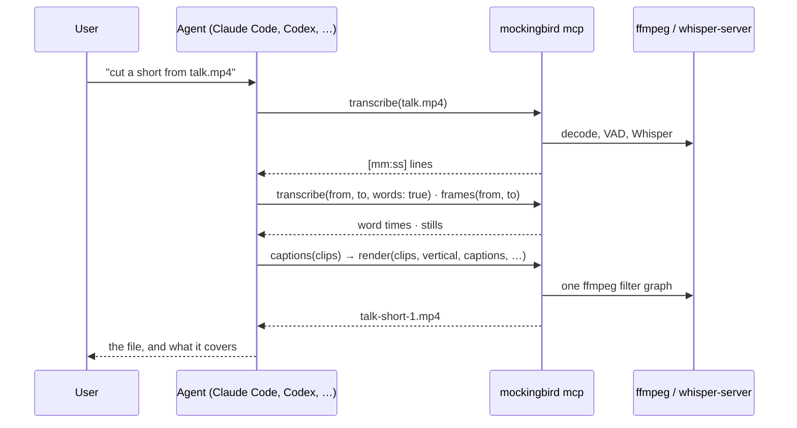

# mockingbird — architecture

> **Status:** pivot step 1 done (#135): dictation is gone, and mockingbird is a
> video editing engine for AI agents, served over MCP. macOS only so far. The
> plan for the rest is [#134](https://github.com/NirjharBhattacharjee/mockingbird/issues/134).
> **Owner:** bhattacharjeenirjhar26@gmail.com
> **Last updated:** 2026-11-03

This document is the single source of truth for what mockingbird is, what it's
built from, and why. When architecture changes, this file changes in the same
PR.

The dictation-era version of this document (the Fn hotkey state machine, text
injection, the cleanup model, the launchd agent) is in git:
`git show v0.3.2:docs/ARCHITECTURE.md`.

## Changelog

| Date | Change |
|---|---|
| 2026-11-04 | Timeline, first part (#148): `packages/timeline` keeps an edit in a project file; the `edit` tool changes it with ops; `render` renders one, with clips from several sources framed to one size and rate, and captions made for the cut. |
| 2026-11-04 | mockingbird-studio moved into `plugin/` and is now the `mockingbird` plugin; a `guide` tool and server instructions give every MCP client its playbooks (#140). |
| 2026-11-04 | Long-form fixes (#127): `render` and `motion` reach −14 LUFS with a measured gain and a limiter instead of one pass of `loudnorm` (−15.9 → −14.3 LUFS on the v2 edit); `captions` hears overlapping padded clips as one stretch (171 s → 62 s for 96 clips); captions in a wide video are subtitle-sized. |
| 2026-11-03 | `render` opens the source once per clip with a seek instead of trimming one input: 2.4x faster on a 96-clip edit, and frame-accurate. Over 100 clips it renders in batches and joins them, to bound memory (#137). |
| 2026-11-03 | Pivot step 1 (#135). Deleted dictation and the meeting recorder: `packages/{hotkey,inject,context,llm,cue}`, mic capture and the system audio tap in `packages/audio`, the launchd agent, the pipeline and its FSM, learning, calibration, Ollama, the Bubble Tea screens and TUI.md. The dictionary's parsing and name matching moved to `packages/store`. With no daemon, every process opens `data.db` read-write. `apps/daemon/src/agent.ts` is now a stub that removes an upgraded Mac's leftover agent. |
| 2026-11-02 | `motion` draws gradient-outlined text, and refuses a font that isn't installed instead of falling back to Helvetica (#133). |
| 2026-11-01 | `motion`: Path2D, `ctx.filter`, and sound from the script (#131). Motion graphics written as code, drawn with Core Graphics through `bun:ffi` (`packages/motion`, #129). |
| 2026-10-31 | `render` gains framing, word captions, text, b-roll and sound for shorts (#126). |
| 2026-10-24 | `mockingbird mcp`: the engine's tools over the Model Context Protocol (#88). |

## Table of contents

1. [What this is](#1-what-this-is)
2. [Core principles](#2-core-principles)
3. [Technology stack](#3-technology-stack)
4. [How an edit flows](#4-how-an-edit-flows)
5. [The tools](#5-the-tools)
6. [Transcription](#6-transcription)
7. [Rendering](#7-rendering)
8. [State](#8-state)
9. [Everything is local](#9-everything-is-local)
10. [Repository layout](#10-repository-layout)
11. [Packaging](#11-packaging)
12. [Distribution](#12-distribution)
13. [Upgrading from dictation](#13-upgrading-from-dictation)
14. [CI/CD pipeline](#14-cicd-pipeline)
15. [Roadmap](#15-roadmap)
16. [Known gaps](#16-known-gaps)
17. [Versioning & how this doc evolves](#17-versioning--how-this-doc-evolves)

---

## 1. What this is

mockingbird is the engine an AI agent edits video with. The user brings the
agent (Claude Code, Codex, Cursor, Gemini CLI, any MCP client) and its
subscription; mockingbird gives it tools to read footage (transcripts with
word times, stills), and to cut, frame, caption, animate and render it. The
agent decides the edit. mockingbird runs ffmpeg, Whisper and its own
renderers on the user's computer, and never calls a model or a server.

The editing know-how (hooks, pacing, caption style, motion design) lives in
[`plugin/`](../plugin/README.md) as skills, a reviewer agent and a motion
design kit. Claude Code installs it as a plugin; every other agent gets the
same playbooks from the `guide` tool, which reads each skill's `SKILL.md`
(`apps/daemon/src/guide.ts`). The server's instructions, sent on connect,
point the client's model at it.

## 2. Core principles

Constraints, not preferences. Check any proposed change against them.

1. **Two languages, each with one job.** The engine (`apps/daemon` and every
   `packages/*`) is TypeScript on Bun. The `mockingbird` command users type
   is Go, in `apps/cli` only; today it finds the engine and hands it every
   command. Third-party programs (ffmpeg, whisper-server) run as
   subprocesses. We never write a `.swift`, `.mm` or `.rs` file; native
   macOS APIs are reached through `bun:ffi`.
2. **No Electron, no native GUI toolkit.** A future preview runs as a local
   page in the browser.
3. **Local-first, no exceptions.** No network call happens in normal
   operation. The only network activity is a download the user asks for
   (`mockingbird models pull`). See [§9](#9-everything-is-local).
4. **Headless-testable.** Every tool runs and is tested with no GUI, no mic
   and no permission prompt: feed it a file, assert on the output.
5. **Degrade, don't break.** A missing piece narrows what works instead of
   stopping everything: no dictionary means names come out as heard, no
   Core Text captions means ffmpeg's `subtitles` filter or a sidecar `.srt`.

## 3. Technology stack

| Concern | Technology | Runs as |
|---|---|---|
| Engine | TypeScript on **Bun** ≥ 1.2, Bun workspaces | our process |
| Command | **Go** ≥ 1.26, `apps/cli` | one compiled binary |
| Decoding, cutting, mixing, encoding | `ffmpeg` | subprocess |
| Speech detection | Silero VAD via `onnxruntime-node` | native module in-process |
| Speech-to-text | `whisper.cpp`'s `whisper-server`, default model `large-v3` Q5_0 | subprocess, HTTP on a free `127.0.0.1` port per call |
| Captions | Core Text through `bun:ffi`, drawn to PNGs that ffmpeg overlays | in-process |
| Motion graphics | Canvas 2D API implemented over Core Graphics, Core Text and vImage through `bun:ffi` | in-process, the script under `sandbox-exec` |
| Storage | `bun:sqlite` (`data.db`: the dictionary and settings) | in-process |
| Agent protocol | MCP, JSON-RPC over stdin/stdout | `mockingbird mcp` |
| Tests | `bun test`, `go test` | — |

**Is X allowed?** If we call it with `fetch()`, `Bun.spawn()`, or load it as
a prebuilt N-API module, yes, whatever it's written in. If it needs a
`.swift`, `.mm` or `.rs` file we write ourselves, no.

## 4. How an edit flows



`render` can take the whole edit in its parameters, as above, or render a
project file the agent builds up with `edit` (pivot step 5, #148): clips
from any number of sources, with texts, b-roll and sounds attached to the
clips they belong to, so changing the cut doesn't break their timing.

## 5. The tools

The MCP server (`apps/daemon/src/mcp.ts`) is the product's surface. Each
tool, with its options, is documented in [MCP.md](./MCP.md):

| Tool | Does |
|---|---|
| `transcribe` | timestamped lines, or word times, for a file or a stretch of it |
| `frames` | stills at an interval, for the agent to look at |
| `captions` | word-by-word SRT timed to the video `render` will make |
| `edit` | changes a project file with ops (add, remove, split, trim, move, set) and returns an outline |
| `render` | a project, or cuts from one video: framing, 9:16 or split layout, captions, text, b-roll, music and sound effects, loudness to −14 LUFS |
| `motion` | a script that draws with the Canvas 2D API, rendered to MP4 |
| `status` | what's installed |
| `dictionary_list`, `dictionary_add` | names to spell right |

`mockingbird transcribe`, `dictionary`, `models` and `status` are the same
functions as plain commands.

## 6. Transcription

`transcribe` and `captions` decode the file with ffmpeg to 16 kHz mono, find
speech with Silero VAD, cut it into chunks of up to 30 seconds, and send
each to a whisper-server started for that call on a free port. Word times
come back per chunk and are offset to the file. Names are then fixed from
the dictionary: a `heard => term` entry replaces that exact phrase, and any
stretch of one to three words that sounds like a term (a consonant skeleton
compared by edit distance, `packages/store/src/dictionary.ts`) is replaced
by it.

The model is `MOCKINGBIRD_ASR_MODEL` if set, else the one
`mockingbird models use` saved in `data.db`, else `large-v3` Q5_0, else the
best earlier default that's downloaded. `MOCKINGBIRD_LANGUAGE` sets the
language (default `en`, or `auto`). Per-call `model` and `language`, and a
model per language, come in pivot step 3. [MODELS.md](./MODELS.md) has the
measurements behind the default.

## 7. Rendering

`render` builds one ffmpeg filter graph from its parameters: each clip is
its own input, the source opened at the clip's start (`-ss`) and read for
its length (`-t`), so only what's kept is decoded. Then a crop and scale per
clip for framing and zoom (or two crops stacked for a split), `concat`,
overlays for b-roll, then the captions and text as PNG overlays drawn by
`packages/captions` with Core Text, and an audio graph that mixes music and
effects under the speech with sidechain ducking. The sound is written
uncompressed, then `level` brings it to −14 LUFS: it measures the file,
measures again through a 4x-oversampled limiter at −2 dB (peaks stay under
−1.5 dBTP after AAC), corrects the gain once, and copies the picture into
the final MP4 without encoding it again. `motion`'s sound mix goes through
the same step.
It never overwrites a file.

Each input costs a decoder, about 23 MB at 1080p, so one pass opens at most
100 clips (`CLIPS_PER_PASS`). More are cut and joined in batches of 100,
encoded near-lossless (x264 CRF 10, PCM sound), joined with the concat
demuxer, and then given the overlays, sound and loudness in one last pass.
Measured on an M3 with a 96-clip edit of a 908 s 1080p60 recording
(#137): 152.9 s with one trimmed input, 63.4 s seeking, 103.1 s in two
batches. VideoToolbox's H.264 encoder was slower than x264 `veryfast` there
(about 213 fps against 557), so encoding stays on x264.

A project (`packages/timeline`) compiles into the same inputs: each clip
with its own source, everything laid over the cut timed in the finished
video from the clip it's on, and captions made with `wordCaptions` from each
source's words. Its clips can differ in size and frame rate, so each is
cropped to the project's shape, scaled to its size and set to its rate
before `concat`, and a clip from a source with no sound gets silence
(`aevalsrc`). The package does no I/O beyond reading and writing the
project file; probing and rendering stay in the engine.

`motion` imports the agent's script in a separate Bun process under
`sandbox-exec` with the network denied (`apps/daemon/src/motion-run.ts`),
calls its `draw(ctx, t, m)` for every frame against `packages/motion`'s
Canvas, and pipes raw frames to ffmpeg.

Pivot step 7 replaces `packages/motion` (macOS only) with HTML and CSS
rendered in a pinned headless Chrome; see #134.

## 8. State

There's no daemon and nothing runs in the background. Each command and each
MCP server is its own short-lived process.

| What | Where | Written by |
|---|---|---|
| Dictionary, settings | `~/.mockingbird/data.db` ([DATABASE.md](./DATABASE.md)) | any mockingbird process (WAL, 5 s busy timeout) |
| Models | `~/.mockingbird/models/` | `mockingbird models pull` |
| Renders, stills | beside the source, or a temp folder for stills | `render`, `motion`, `frames` |

`MOCKINGBIRD_HOME` moves `~/.mockingbird`.

## 9. Everything is local

- **No cloud model.** Transcription runs in whisper-server, bound to
  `127.0.0.1`. The agent's model is the agent's business: what a tool
  returns goes wherever that agent sends it ([MCP.md](./MCP.md#where-your-text-goes)).
- **No telemetry, no analytics, no crash reporting.** If opt-in usage stats
  are ever added, they're off by default and asked for separately from
  setup.
- **No account, no login, no license server.**
- **The only network activity is a download the user runs**
  (`mockingbird models pull`), which names each URL and checks each file's
  sha256. mockingbird never checks for updates.
- **`mockingbird mcp` opens no port.** It speaks over stdin and stdout to the
  agent that started it.
- **An agent's motion script can't reach the network.** It runs under
  `sandbox-exec` with `deny network*`.

Pivot step 3 adds one more explicit, user-approved download in
`mockingbird setup`: a pinned headless Chrome for the HTML motion engine.

## 10. Repository layout

```
mockingbird/
├── apps/
│   ├── daemon/src/          the engine (the name predates the pivot)
│   │   ├── cli.ts           every command
│   │   ├── mcp.ts           the MCP server and its tools
│   │   ├── guide.ts         the plugin's playbooks, served by `guide`
│   │   ├── motion-run.ts    runs a motion script in its own process
│   │   ├── transcribe.ts    `mockingbird transcribe`
│   │   ├── dictionary.ts    `mockingbird dictionary`, data.db access
│   │   ├── models.ts        `mockingbird models`, pinned downloads
│   │   ├── runtime.ts       model lookup, VAD + whisper-server startup
│   │   ├── uninstall.ts     `mockingbird uninstall`
│   │   ├── retire.ts        removes what dictation left on a Mac (§13)
│   │   └── agent.ts         stub launchd still runs on upgraded Macs
│   └── cli/                 `mockingbird`, the Go command
├── packages/
│   ├── audio/               file decoding through ffmpeg, WAV, PCM helpers
│   ├── vad/                 Silero ONNX wrapper
│   ├── asr/                 whisper-server adapter, word diff (WER)
│   ├── captions/            SRT parsing, captions drawn with Core Text
│   ├── motion/              Canvas 2D over Core Graphics, motion scripts to MP4
│   ├── timeline/            project files: format, checks, edit ops, outline
│   └── store/               data.db, the dictionary's parsing and name matching
├── plugin/                  the Claude Code plugin: skills, the reviewer agent,
│                            the motion kit, templates, sound effects, research
├── .claude-plugin/          the marketplace file that points at plugin/
├── bench/                   Whisper model comparison over a synthetic corpus
├── scripts/                 install.sh, fixture generation
└── .github/workflows/       ci.yml, release.yml
```

Two rules, load-bearing:

1. `packages/*` never imports from `apps/*`.
2. Platform-specific code stays inside `packages/*` (`audio`, `captions`,
   `motion`) so the Linux and Windows ports in step 4 touch those and
   nothing else.

## 11. Packaging

The engine ships as source and runs on Bun. `bun build --compile` isn't used
yet: it embeds the `onnxruntime-node` addon but not the
`libonnxruntime.1.dylib` it links against, so VAD fails at runtime.

The `mockingbird` command is a Go binary from `apps/cli`. It finds the engine
through `MOCKINGBIRD_ROOT` or by walking up from its own path, and replaces
itself with `bun apps/daemon/src/cli.ts <args>`.

## 12. Distribution

- **Homebrew:** `brew install nirjharbhattacharjee/mockingbird/mockingbird`.
  The formula downloads the release's source tarball, checks its sha256,
  runs `bun install --production` into `libexec`, builds the Go command with
  Homebrew's `go`, and writes a shim that sets `MOCKINGBIRD_ROOT`.
- **`install.sh`:** `curl -fsSL …/releases/latest/download/install.sh | bash`.
  Installs Bun, whisper-cpp and ffmpeg with Homebrew, clones the repo at the
  newest release tag on `main`, downloads that release's Go binary and checks
  it against `checksums.txt`, runs `models pull`, and writes
  `~/.local/bin/mockingbird`. Each step logs to `~/.mockingbird/logs/`.
- **From a clone:** `bun install`, then `bun apps/daemon/src/cli.ts`.

Updating is always something the user runs: the install command again, or
`brew upgrade`.

Release binaries are only ad-hoc signed (Go's linker does it), not signed
with a Developer ID or notarized: that needs a paid certificate the
maintainer doesn't have yet. Neither install path hits Gatekeeper, because
`curl` and Homebrew don't set `com.apple.quarantine`. Only a browser
download does; the [user guide](./README.md#apple-could-not-verify-mockingbird)
explains what that looks like and the way past it.

## 13. Upgrading from dictation

v0.3.2 and earlier installed a launchd agent
(`~/Library/LaunchAgents/com.mockingbird.agent.plist`) that ran
`apps/daemon/src/agent.ts` through a copy of bun in
`~/.mockingbird/bin/mockingbird.app`, and `mockingbird fn` may have changed
the system Fn setting. After an upgrade, `agent.ts` is a stub: the next time
launchd starts it, it calls `retireDictation()` (`retire.ts`), which puts the
Fn setting back from `~/.mockingbird/fn-key.json`, removes the app and the
plist, and boots the agent out. `install.sh` and `mockingbird uninstall` call
the same function. The old `data.db` is migrated: its words stay, learned
ones included, and the dictation tables go ([DATABASE.md](./DATABASE.md)).

## 14. CI/CD pipeline

**`ci.yml`**, on every push and pull request:

1. `check` (macOS): `bun install --frozen-lockfile`, `bun run typecheck`,
   `bun run lint` (Biome), `bun test`. Integration tests
   (`MOCKINGBIRD_INTEGRATION=1`) need whisper-server, ffmpeg and downloaded
   models, so they run locally with `bun run test:integration`.
2. `cli` (macOS): `gofmt`, `go vet`, `go test -race` in `apps/cli`.
3. `dco` (pull requests): every commit carries a `Signed-off-by` line for
   its author ([CONTRIBUTING.md §11](../CONTRIBUTING.md#11-contributor-licensing--dco-not-a-cla)).

**`release.yml`**, on a `v*.*.*` tag:

1. Refuse a tag that isn't on `main`.
2. Rerun the checks on the tagged commit.
3. Build `apps/cli` into `mockingbird-darwin-arm64` with the tag built in.
4. Pack the source with `git archive`, and write the sha256 of it, the
   binary and `install.sh` to `checksums.txt`.
5. Create the GitHub Release with those files. A tag with a `-` is a
   prerelease, which the installer only takes with `MOCKINGBIRD_CHANNEL=beta`
   and the tap never does.
6. Open a PR on `NirjharBhattacharjee/homebrew-mockingbird` with the new
   `url` and `sha256` (needs the `TAP_TOKEN` secret).

**`main` is staging, releases are production.** Rulesets require a pull
request, squash merges, green `check` and `cli`, and resolved threads on
`main`, and let only an admin create a `v*` tag.

## 15. Roadmap

From [#134](https://github.com/NirjharBhattacharjee/mockingbird/issues/134),
each step shippable on its own:

1. ~~Delete dictation~~ (#135).
2. Render speed on today's engine: hardware encoding, parallel segments.
3. Plugin and install: mockingbird-studio moves into `plugin/`; `setup`,
   `doctor`, `record`, `guide` over MCP; model and language per call.
4. Linux and Windows.
5. The timeline: `project.json` and edit verbs.
6. Render pipeline: segment cache, smart stream copy, proxies.
7. The HTML motion engine in a pinned headless Chrome, and Web Audio music.
8. Effects catalog, phase 1: color, scopes, transitions, speed, audio cleanup.
9. Effects catalog, phase 2: keying, masks, stabilization; FCPXML and OTIO export.
10. Self-hosted cloud.
11. Effects catalog, phase 3: tracking, AI masks, multicam.

## 16. Known gaps

- **macOS only.** Captions and motion use Core Text and Core Graphics.
- **No compiled engine** ([§11](#11-packaging)): Bun has to be installed.
- **One render call per edit.** Any change re-renders everything (step 5).
- **The agent sees a few stills, not the video.** Tool outputs stay small so
  an edit doesn't use up the user's subscription; token cost per edit isn't
  measured yet.
- **No eval** of edit quality: pacing, caption accuracy, reviewer pass rate.

## 17. Versioning & how this doc evolves

- A PR that changes architecture, data handling, a model or a tool updates
  the matching doc (this one, [SECURITY_PRIVACY.md](./SECURITY_PRIVACY.md),
  [MODELS.md](./MODELS.md), [DATABASE.md](./DATABASE.md), [MCP.md](./MCP.md))
  in the same PR, and adds a changelog row here when it changes this one.
- Releases follow semver on the git tag. The `0.x` series can still change
  any tool's parameters; the timeline in step 5 will.
