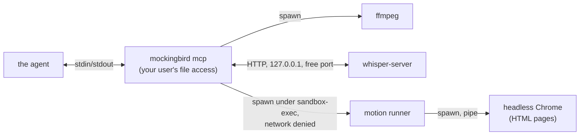

# mockingbird — security & privacy

> **Owner:** bhattacharjeenirjhar26@gmail.com
> **Last updated:** 2026-11-03 (dictation removed, #135)
>
> Where something is a guarantee enforced in code, this says so. Where it's
> an open risk, it says that instead. This file is not marketing copy.

mockingbird is built around one sentence: **your footage never leaves your
computer because of mockingbird.** Raw video is about as private as data
gets: faces, voices, homes, screens, other people. This document makes that
claim checkable, and is honest about what local-first doesn't cover, chiefly
that the AI agent driving mockingbird decides where tool results go.

The dictation-era version (microphone, Accessibility and Input Monitoring
grants, dictation history) is in git: `git show v0.3.2:docs/SECURITY_PRIVACY.md`.

## Table of contents

1. [Threat model](#1-threat-model)
2. [Data inventory — what mockingbird actually touches](#2-data-inventory--what-mockingbird-actually-touches)
3. [Network policy](#3-network-policy)
4. [macOS permissions](#4-macos-permissions)
5. [At-rest storage & retention](#5-at-rest-storage--retention)
6. [Process & trust boundaries](#6-process--trust-boundaries)
7. [Supply chain & install integrity](#7-supply-chain--install-integrity)
8. [Known privacy issues — open, unresolved](#8-known-privacy-issues--open-unresolved)
9. [Hardening roadmap](#9-hardening-roadmap)
10. [Reporting a vulnerability](#10-reporting-a-vulnerability)

---

## 1. Threat model

**Defended against:**

- A remote party (us, a cloud API, an analytics SDK) seeing your footage,
  transcripts or renders, or learning that you use mockingbird, because of
  anything mockingbird does.
- A page an agent writes for `motion` reaching the network
  ([§6](#6-process--trust-boundaries)).

**Not defended against:**

- **The agent you connect.** Whatever a tool returns (a transcript, still
  paths the agent then opens, file names) goes wherever that agent sends it.
  With a cloud-hosted model, that's its provider. That's your choice of
  tool, and [MCP.md](./MCP.md#where-your-text-goes) says so where the
  server is set up.
- **A local attacker running code as you**, or malware on the machine. It
  can read your videos and `~/.mockingbird` directly, and reach a
  whisper-server on `127.0.0.1` while a transcription runs.
- **A compromised mockingbird release.** It runs with your user's file
  access. [§7](#7-supply-chain--install-integrity) is the control.

## 2. Data inventory — what mockingbird actually touches

| Data | Sensitivity | Where | Persisted? |
|---|---|---|---|
| Your source videos and audio | High | wherever you keep them; read, never moved or changed | yours |
| Decoded audio | High | memory, and HTTP over loopback to whisper-server | no |
| Transcripts and word times | High | returned to the agent | no, unless the agent saves them |
| Stills (`frames`) | High | a new temp folder per call | yes, until the OS clears temp |
| Renders | High | beside the source, or where `out` says | yes, they're the point |
| Dictionary (names, jargon) | Medium | `data.db`, `dictionary` | yes, until removed |
| Settings (the model in use) | Low | `data.db`, `settings` | yes |
| Model weights | None (public files) | `~/.mockingbird/models/` | yes |
| Headless Chrome | None (public files) | `~/.mockingbird/bin/` | yes |
| Install logs | Low | `~/.mockingbird/logs/` | yes |

An upgraded Mac may still have dictation's `~/.mockingbird/recordings/` and
`calibration/` folders. Nothing reads them now; `mockingbird uninstall` asks
about recordings before deleting `~/.mockingbird`.

## 3. Network policy

Enforced by [ARCHITECTURE.md §9](./ARCHITECTURE.md#9-everything-is-local):

- **No cloud model in mockingbird.** whisper-server runs on `127.0.0.1`, on
  a free port, only for the length of a call.
- **No telemetry, analytics or crash reporting.** Any future opt-in stats
  are off by default and asked for on their own.
- **No account, login or license server.**
- **The only download is one you run:** `mockingbird models pull`, which
  prints each URL and checks each file against a pinned sha256.
  `mockingbird setup` runs the same download after showing its size and
  hosts, and `brew install` for a missing ffmpeg or whisper-cpp after naming
  them; each only on a yes (or `--yes`). Homebrew fetches and checks its
  own downloads. No update checks.
- **The only download is one you run:** `mockingbird models pull`, and
  `models pull chrome` for the headless Chrome `motion` renders HTML in.
  Each prints its URL and checks the file against a pinned sha256. No
  update checks.
- **`mockingbird mcp` opens no port.** The agent starts it and talks over
  stdin and stdout.
- **The stack rule is a security control.** Every dependency is code in
  this repo or a program we spawn with arguments we control
  ([ARCHITECTURE.md §3](./ARCHITECTURE.md#3-technology-stack)).

## 4. macOS permissions

None. Reading and writing files the user points at needs no TCC grant. A
folder macOS protects (Desktop, Documents, Downloads) prompts for the
terminal or agent app that runs mockingbird, the first time, as it would for
`ls`. `mockingbird record` needs the microphone: macOS asks once, for the
terminal it runs in, and the answer is that terminal's to keep or revoke in
System Settings → Privacy & Security → Microphone. It records only while the
command runs and only into the file it was given; a recording that comes out
silent says where to look, since a denied mic records silence rather than
failing.

## 5. At-rest storage & retention

- `data.db` is unencrypted SQLite holding the dictionary and settings
  ([DATABASE.md](./DATABASE.md)). Nothing in it expires.
- Stills go to `mkdtemp` folders under the system temp directory.
- Renders never overwrite an existing file.
- `mockingbird uninstall` removes `~/.mockingbird`, the code and the
  command, after offering to copy the dictionary out.

## 6. Process & trust boundaries

- **`motion` runs a page the agent wrote** ([MCP.md](./MCP.md#motion-graphics)).
  Each call starts a new Bun process under `sandbox-exec` with every network
  operation denied, so the page, and the Chrome it runs in, can't reach the
  network. It can still read and write files as you, which is no more than
  an agent with a shell has, but an agent with only file-writing tools gains
  a way to run code. The server never fetches a page; it runs a path the
  agent gives it. An agent that shouldn't run code on your computer
  shouldn't be given `mockingbird mcp`.
- **An HTML page renders in Chrome inside that sandbox.** Chrome is
  started from the sandboxed process, so the network is denied to it and
  to the page as well; a `fetch` from a page fails there. Chrome's own
  sandbox can't start inside another, so it runs with `--no-sandbox`. The
  page can read files as you, through `file://`, as a script can. Chrome is
  pinned to one version and checked against its sha256 when pulled. A
  security fix in Chrome reaches users only when mockingbird bumps the pin,
  so the pin should move with Chrome's stable releases.
- **Every tool reads any path the agent passes.** The agent can usually
  read those files itself; mockingbird adds no new reach.
- **Model files and media are untrusted input to native code.** whisper.cpp,
  onnxruntime and ffmpeg are C/C++. Models are sha256-pinned; media isn't
  and can't be, so a malicious video is as dangerous as it is to ffmpeg
  anywhere.

## 7. Supply chain & install integrity

- **`scripts/install.sh`** trusts GitHub and this repo, as `git clone` does:
  it checks out the newest release tag on `main`. What it fetches elsewhere
  is verified: Homebrew formulas by sha256, the Go binary against the
  release's `checksums.txt`, models against pinned sha256s. If Homebrew is
  missing and you agree, it runs Homebrew's own installer, unpinned, as
  brew.sh says to.
- **The Homebrew formula** pins each release's source tarball by sha256.
  CI opens the PR that bumps it and a person merges it. `bun install`
  inside it is checked against `bun.lock`.
- **Updates are never automatic.** A silent updater would be unannounced
  network activity and a way to compromise every install at once.

## 8. Known privacy issues — open, unresolved

1. **The agent sees what it asks for.** A transcript of a private recording
   goes to a cloud model if the agent uses one. Local-model agents avoid it.
2. **Stills sit in temp folders** until macOS clears them.
3. **Backups** (Time Machine, sync tools) copy `data.db` and renders like any
   other file.
4. **`models pull` tells the host** (Hugging Face, GitHub, Google for Chrome) which file you
   fetched, from your IP, at that time. Disclosed, user-run, still a leak.
5. **The dictionary can be more sensitive than it looks**: client names,
   codenames, people's names.

## 9. Hardening roadmap

1. A compiled, signed engine binary (blocked on `onnxruntime-node`'s dylib,
   [ARCHITECTURE.md §11](./ARCHITECTURE.md#11-packaging)).
2. A CI check that runs every tool on fixtures with the network denied and
   fails on any non-loopback connection.
3. Delete stills when the MCP session ends.
4. whisper-server on a Unix socket instead of a loopback port.
5. GitHub private vulnerability reporting, so [SECURITY.md](../SECURITY.md)
   is backed by Advisories.

## 10. Reporting a vulnerability

Don't open a public issue. Report privately to
bhattacharjeenirjhar26@gmail.com; [SECURITY.md](../SECURITY.md) has the
details.
